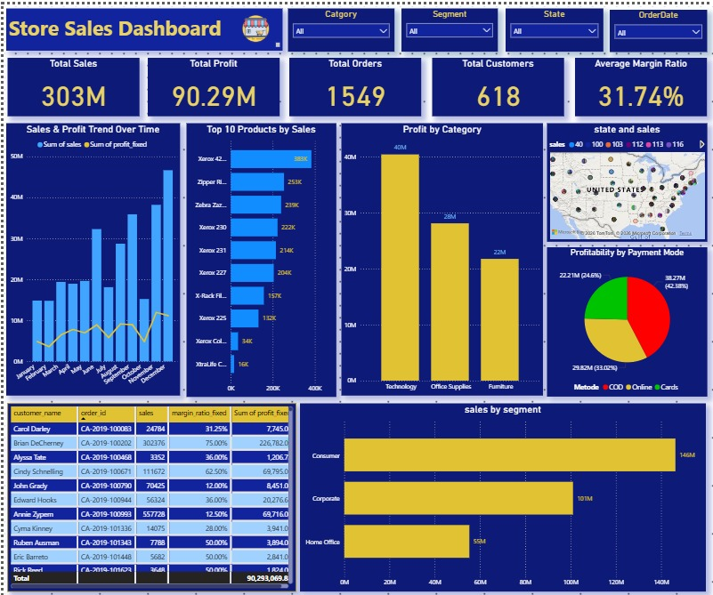

# SuperStore Sales Dashboard - Power BI  
 
Proyek ini merupakan implementasi **dashboard interaktif** menggunakan **Microsoft Power BI** untuk menganalisis penjualan pada dataset *SuperStore*. Dashboard ini dirancang untuk memberikan wawasan bisnis secara cepat dan visual, sehingga membantu pengambilan keputusan berbasis data.  

---

## 📊 Fitur Dashboard  
1. KPI Utama 
   - Total Sales  
   - Total Profit  
   - Total Orders  
   - Total Customers  
   - Average Margin Ratio  

2. Visualisasi Data
   - Sales & Profit Trend Over Time 
   - Top 10 Products by Sales 
   - Profit by Category
   - Sales by Segment 
   - Profitability by Payment Mode 
   - State and Sales Map 
   - Customer Detail Table


## 🗂 Struktur Repository  
```

├── Dashboar_SuperStore_Sales_PowerBI.png   # Screenshot dashboard
├── SuperStore_Sales_Dashboard.pbix         # File Power BI Dashboard
├── data_fixed.xlsx                         # Dataset SuperStore (fixed version)
└── README.md                               # Dokumentasi project

````

## 📷 Tampilan Dashboard



---

## 📌 Tools & Teknologi

*  
*  

---

## Kolom utama yang dipakai:
order_id, order_date, ship_date, ship_mode, customer_name, segment, country, city, state, region, category, sub-category, product_name, sales, quantity, profit (original), profit_fixed, margin_ratio_fixed, payment_mode

---

## Langkah cleaning / normalisasi yang dilakukan (ringkasan):
* Data mentah mengandung baris dengan nilai tidak valid dan margin ekstrem yang bisa menyesatkan analisis. Langkah yang dilakukan:
  1. Menghitung margin_ratio = profit / sales.
  2. Menghapus baris dengan sales <= 0 atau margin ekstrem.
  3. Mengoreksi baris dengan margin > 80%: profit_fixed = sales × median_margin.
  4. Menyimpan profit asli sebagai referensi, sedangkan analisis dan visualisasi memakai profit_fixed dan margin_ratio_fixed.


## ✨ Insight Utama

Ringkasan kinerja: Total Sales ±303 juta, Total Profit ±90,29 juta, 1.549 order dari 618 pelanggan.
* 💻 Technology adalah kategori paling menguntungkan: ±40 juta, sekitar 44% dari total profit. Office Supplies ±28 juta dan Furniture ±22 juta.
* 👥 Segmen Consumer menyumbang sales terbesar: ±146 juta (±48% dari total), disusul Corporate ±101 juta dan Home Office ±55 juta.
* 📈 Rata-rata margin ratio 31,74%. Margin keseluruhan (total profit ÷ total sales) sekitar 29,8%. Selisihnya wajar karena rata-rata margin dihitung per baris transaksi.
* 💳 COD menyumbang profit terbesar (±38,3 juta, 42,4%), disusul Online (±29,8 juta, 33,0%) dan Cards (±22,2 juta, 24,6%). Angka ini menunjukkan kontribusi profit, bukan margin per metode pembayaran.
* 🏆 Produk dengan penjualan tertinggi adalah Xerox 42L (±383 ribu). 6 dari 10 produk teratas adalah produk Xerox.
* 📅 Sales cenderung naik menjelang akhir tahun: puncaknya Desember (±47 juta), disusul November dan September. Bulan Juni juga melonjak, sedangkan Oktober turun tajam.
* ⚠️ Profit tampak relatif datar meski sales naik: garis profit bergerak di kisaran ±4–12 juta per bulan, sehingga pertumbuhan sales tidak diikuti pertumbuhan profit yang sepadan.

---

## 💡 Rekomendasi Bisnis
1. Technology menyumbang ±44% profit:	Prioritaskan ketersediaan stok Technology dan arahkan anggaran promosi ke kategori ini
2. Consumer menyumbang ±48% sales; Home Office paling kecil (±18%):	Fokuskan program loyalitas pada Consumer, dan evaluasi apakah Home Office punya potensi tumbuh atau perlu pendekatan berbeda
3. Sales memuncak di September, November, dan Desember:	Siapkan stok dan kapasitas pengiriman sebelum kuartal akhir, dan rancang promosi untuk bulan yang lemah seperti Oktober
4. Sales naik tetapi profit relatif datar:	Telusuri penyebabnya (diskon, biaya, atau bauran produk) dan targetkan pertumbuhan profit, bukan hanya volume penjualan
5. 6 dari 10 produk terlaris adalah Xerox:	Jaga stok produk-produk teratas, dan kurangi ketergantungan dengan mendorong produk dari merek atau kategori lain
6. COD menyumbang 42,4% profit:	Pertahankan opsi COD, dan evaluasi biayanya (misalnya pengiriman gagal atau retur) sebelum mendorong pelanggan pindah metode

---

## 🔭 Rencana Pengembangan
* Menambahkan analisis profit margin per sub-category untuk menemukan produk yang menjual banyak tetapi marginnya rendah.
* Menganalisis pengaruh diskon terhadap profit.
* Membandingkan performa antar wilayah (region) dengan lebih rinci.

---
## 🧑‍💻 Author

Created by **Adi Dwi RiBowo**

```

